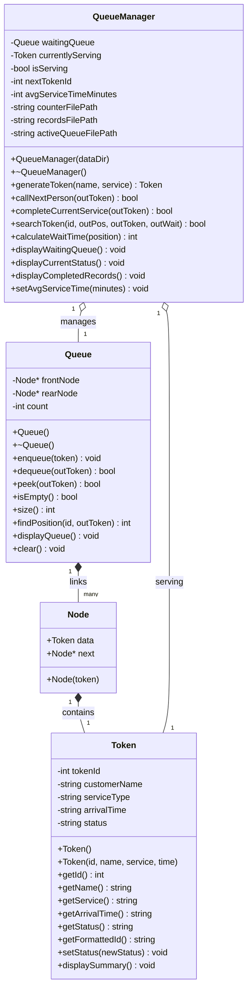
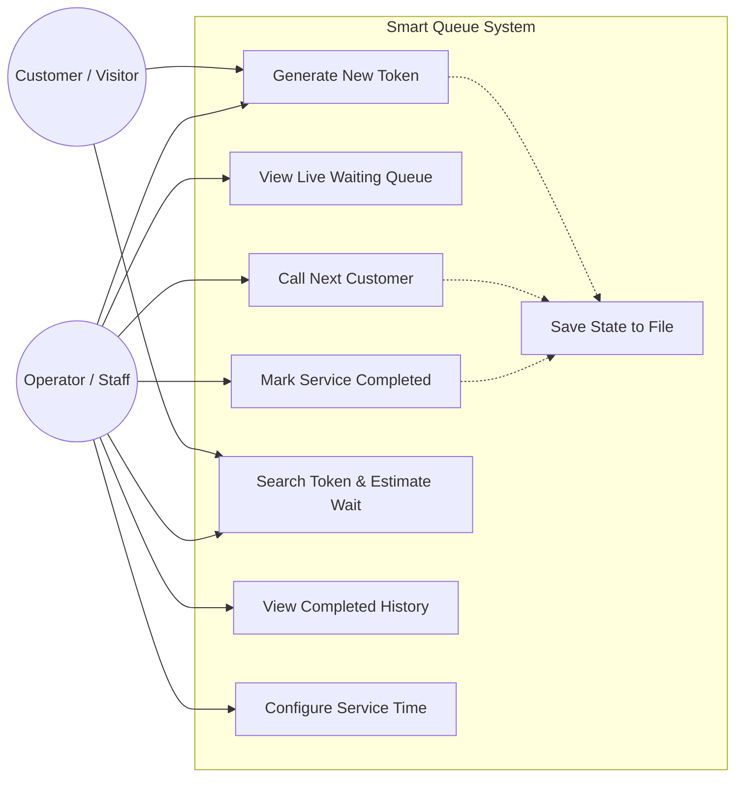
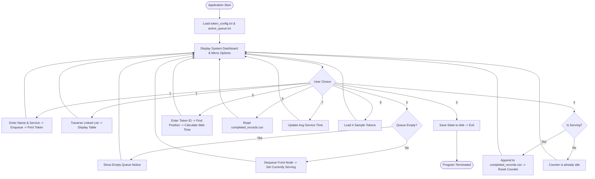

# System Architecture & Design Diagrams
## Smart Queue and Waiting-Time Management System (C++)

This document contains the visual diagrams and design specifications for reports and project presentations.

---

### 1. UML Class Diagram

---

### 2. UML Use-Case Diagram

---

### 3. Program Execution Flowchart

